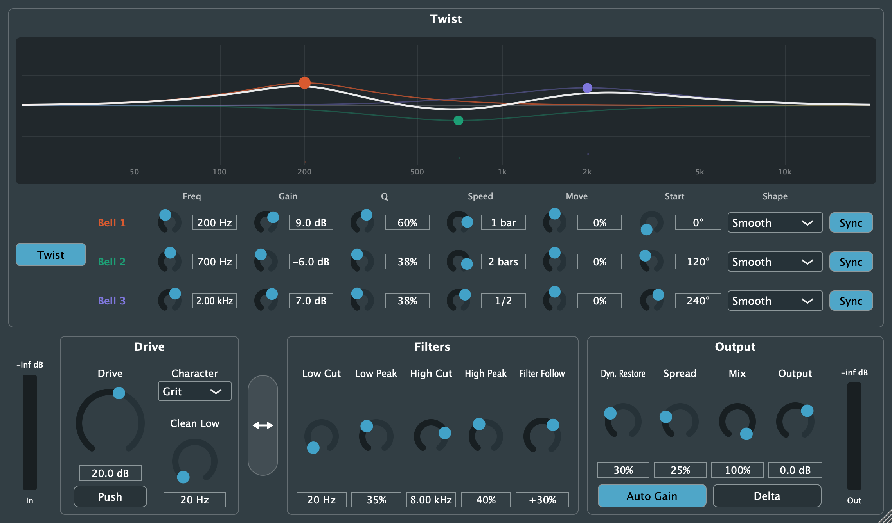
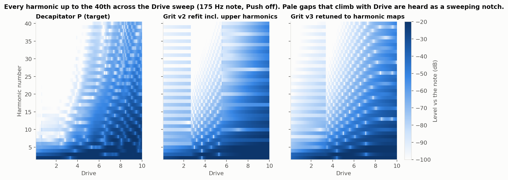

# Rubbish

**A stereo distortion and saturation plugin with screaming resonant filters and EQ that moves on its own.**

Rubbish covers everything from subtle tape warmth to aggressive crunch. It keeps the punch of the original sound and keeps the low end clean. It is inspired by classic tape and tube saturators and by the resonant filters of the Korg MS-20. It runs as an Audio Unit and VST3 in any DAW (developed and tested in Logic Pro).

Built with C++17 and the [JUCE](https://juce.com) framework by Idiot Audio. Measurement and analysis are in Python.



**Case study:** [Matching a commercial saturator with data](docs/case-study.md). It covers how recordings, harmonic analysis and listening tests found why the Grit distortion didn't sound like its reference, and cut the error on the main harmonics from about 12 dB to about 4 dB.

[](docs/case-study.md)

> **Status:** in active development. Version 3 is under way: the movement engine (three LFOs that can be connected to any knob) runs in the audio code, and its on-screen controls are being built.

---

## What it does

### Drive: five distortion Characters
Each Character responds to how hard it is driven, not only in level. Turning Drive up changes which harmonics come through, so the tone changes as well as the amount.

| Character | Sound |
|---|---|
| **Tape** | Warm, soft clipping that squashes rather than getting endlessly dirtier |
| **Tube** | Thick and buzzy; the lopsidedness (and the even-harmonic weight) grows with Drive |
| **Heavy** | Clean at first, then big and weighty, dominated by the 2nd harmonic |
| **Edge** | Almost spotless at low Drive, then bright and biting |
| **Grit** | Dirty from the start, with a tone that keeps evolving as Drive rises |

- **Push** adds 20 dB of extra drive *and* hardens the curve.
- **Clean Low** splits off the bass below a chosen frequency and passes it around the distortion untouched, so low end stays tight.

### Filters
Resonant high-pass and low-pass filters, MS-20 style, that can howl and scream at high resonance while staying stable at every setting.
- **Filter Order:** distort first and then filter, or filter into the distortion ("Scream").
- **Filter Follow:** the input's loudness opens or closes the low-pass on every hit.

### Twist
Three EQ bells after the distortion that sweep by themselves, so a held note keeps moving and evolving. A live display shows the bells and the combined EQ curve, and the bells can be dragged directly.

### Output
- **Dynamics Restore** puts the clean signal's punch back onto the distorted sound.
- **Spread** distorts the stereo sides differently from the centre for width, while staying mono-compatible.
- **Auto Gain** keeps the level steady as Drive changes, so louder never fools the ear.
- **Delta** lets you hear only what the plugin adds.
- An always-on **safety limiter** means output never goes above 0 dBFS.

---

## Under the hood

The parts that took the most engineering:

- **Distortion matched against a commercial reference.** Each Character was fitted by computer search to measurements of a well-known hardware-style saturator, recorded in Logic: total distortion, the balance of the 2nd to 5th harmonics, the upper-harmonic "tail", and maps of every harmonic up to the 40th across the whole Drive range. The write-up is in the [case study](docs/case-study.md). A reproducible Python pipeline (NumPy/SciPy) that measures the recordings, models every version of the distortion and draws the figures is in [`analysis/`](analysis). The raw development notebook is [`decapitator-analysis.md`](decapitator-analysis.md).
- **Clean distortion with no digital fizz.** The distortion stage runs 4x oversampled (`juce::dsp::Oversampling`), its latency is reported to the host, and a DC blocker removes the offset that lopsided curves create.
- **Nothing clicks or zips.** Every audio parameter glides (`juce::SmoothedValue`), and changing Character or Push crossfades between curves.
- **Strict real-time rules.** The audio thread does no memory allocation, locking or blocking.
- **Stable resonant filters** at every setting, including full resonance into full distortion and filters swept by LFOs at full speed.
- **Sessions never break.** Every setting is saved with the DAW project, and older projects are migrated automatically when the parameter set changes (for example, retired Characters open on their nearest replacement).
- **Clean architecture.** One class per DSP block ([`Source/dsp/`](Source/dsp)); the processor only wires the blocks together, and the UI ([`Source/ui/`](Source/ui)) talks to the audio side only through parameters.

### Distortion research bench
[`tools/distortion-bench/`](tools/distortion-bench) is a standalone C++ tool for designing new distortion models offline before they go into the plugin. It runs a recording through a candidate model with Drive swept from 0 to 10, 8x oversampled, then matches its loudness moment by moment to a reference recording for a fair blind comparison. Models so far:
- a Massive-style **sine shaper** (wavefolder) with antiderivative anti-aliasing
- a circuit-level **diode clipper** (resistor, capacitor and silicon diodes), solved with the trapezoidal rule and Newton's method

---

## How it was built

Rubbish is designed and directed by its owner, a music producer, and written with AI assistance ([Claude Code](https://claude.com/claude-code)).

The process is deliberately disciplined:
- a written spec ([`prd.md`](prd.md)) decides what gets built
- work happens in small stages, each one built and heard before the next
- every session is recorded in [`build-log.md`](build-log.md)
- listening tests are logged in [`testing-notes.md`](testing-notes.md)
- `auval` checks every build

---

## Building

Requirements:
- CMake 3.22 or newer
- a C++17 compiler (Xcode on macOS)
- a local copy of JUCE 9.0.5 (dependencies are managed with [CPM](https://github.com/cpm-cmake/CPM.cmake))

```bash
git clone https://github.com/juce-framework/JUCE.git ~/JUCE -b 9.0.5
cmake -B build -DCMAKE_BUILD_TYPE=Release
cmake --build build --config Release
```

The AU and VST3 are copied into your plugin folders after the build. On a Mac you can instead double-click `Build Rubbish.command`, which builds, installs and runs `auval`.

Targets macOS and Windows. Only macOS (Logic Pro) has been tested so far.

### Screenshot tool
[`tools/screenshot/`](tools/screenshot) renders the plugin window to a PNG without a DAW (used for the image above).
