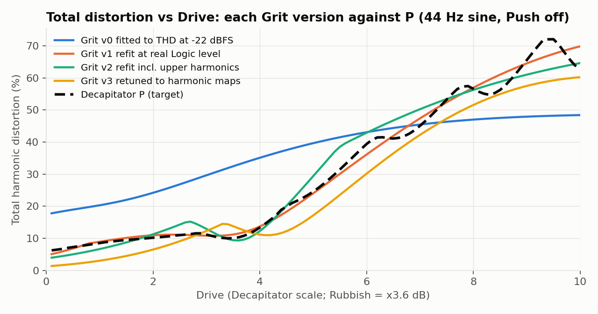
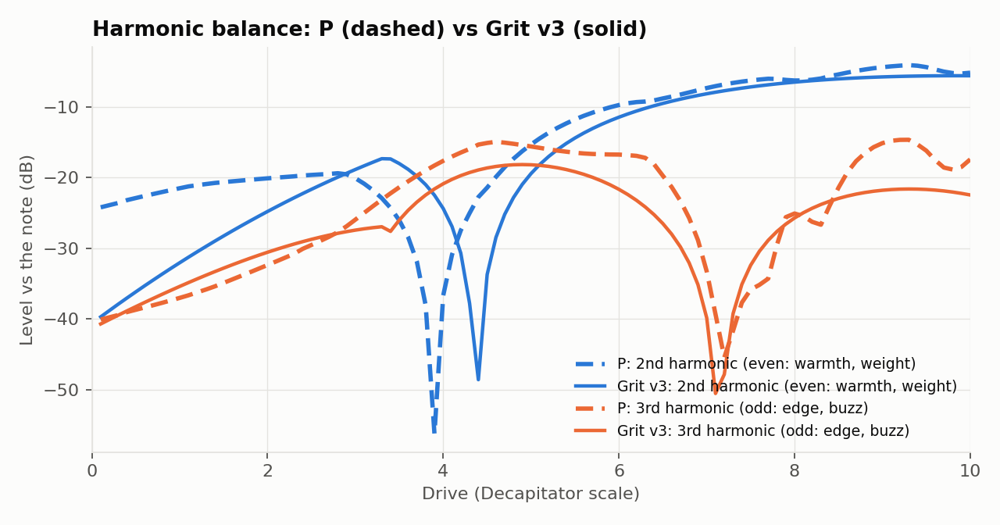
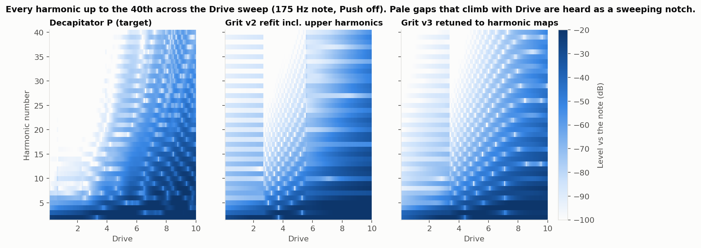

# Case study: matching a commercial saturator with data

**Question:** Rubbish's "Grit" distortion was meant to sound like Soundtoys Decapitator's P style, but in listening tests it didn't. *Why not, and how close can measurement get it?*

**Short answer:** the first model had been fitted to the wrong data in two ways: the wrong input level, and a summary number (total distortion) instead of the recipe of harmonics. Fixing both cut the error on the main harmonics from about 12 dB to about 4 dB. Measuring every harmonic across the whole Drive range then explained an effect a listener noticed (a "notch sweeping up the spectrum" while turning Drive) that the summary numbers couldn't see. The data also showed that no single version wins on every measure, so the final pick was made by ear among measured candidates.

All numbers and figures on this page come from [`analysis/`](../analysis) and can be reproduced in about 20 seconds.

---

## 1. Data collection

- **The reference.** Decapitator P was recorded in Logic Pro on a sine at the level that actually reaches the plugin. Drive was automated from 0 to 10 over 16 bars, giving a continuous sweep instead of a few spot checks. There were three takes (44 Hz and 175 Hz notes with Punish off, and 44 Hz with Punish on), plus recordings on higher notes and a real synth bass to check that P treats every note alike.
- **The model.** Grit's signal chain was copied into NumPy ([`grit_model.py`](../analysis/rubbish_analysis/grit_model.py)) and checked against the plugin's measured output (0.06 dB average difference), so any version can be swept offline in about a second.
- **The measurement.** Harmonics 1–40 were measured relative to the note, every 0.1 Drive, using 0.25 s Blackman-Harris windows ([`harmonics.py`](../analysis/rubbish_analysis/harmonics.py)).

## 2. First finding: the fit used the wrong input level

The first Grit (v0) was fitted with the test sine at −22 dBFS. Checking the session showed the sine actually reached the plugins at about **−13 dBFS**. Earlier recordings had been taken after two faders, which hid 8 dB. Distortion depends heavily on level, so at the real level v0 was **3x dirtier than P at Drive 0** (18% vs 6% total harmonic distortion). It also levelled off at the top while P kept rising.

Refitting at the right level (v1) fixed the overall curve, including P's dip around Drive 3–4 and its climb to about 70%.

## 3. Second finding: matching the total isn't matching the sound

Listening tests still said v1 lacked P's "grit". Total distortion is a single number. Two curves can agree on it and still differ by 15–20 dB in the upper harmonics, which carry the bite. The next fits (v2, v3) also scored the harmonic recipe: the 2nd–5th harmonics, and the combined level of harmonics 6–19 and 20–40.

The chart shows P's character in detail. The warm 2nd harmonic drops out near Drive 4 (a "hollow" moment) and then dominates at high Drive, where P becomes strongly lopsided. Grit v3 follows both turns, a little later than P.

## 4. Third finding: the "sweeping notch" a listener heard

A listener described P as having *"a narrow accentuated notch sweeping up the frequency spectrum as you turn the knob."* Two hypotheses were tested against the recordings:
- **Aliasing.** P doesn't oversample enough, so harmonics fold back as out-of-tune tones. This is confirmed at high Drive on high notes, but it doesn't move with the knob.
- **Something in the curve itself.**

Mapping every harmonic against Drive settled it:

In P (left), single harmonics drop out at particular Drive values, and the gap climbs the harmonic series as Drive rises. With the knob still it sits on one harmonic; while the knob turns it sweeps upward, which is the notch the listener heard. In Grit v2 (middle), the pattern **freezes** from about Drive 6. Its lopsidedness was capped in proportion to the signal, so above that point the waveform's shape, and its harmonic pattern, stopped changing. v3 lets that cap grow with Drive, and its gaps now move through the middle of the range like P's.

## 5. Scoring the versions: no single winner

Mean absolute error against P across the whole Drive sweep (44 Hz, Push off; lower is better). The full tables for all three takes are in [`fit-summary.md`](../analysis/output/fit-summary.md).

| Grit version | H2–H5 (dB) | H6–H19 band (dB) | H20–H40 band (dB) | Total distortion (% points) |
|---|---|---|---|---|
| v0, fitted to total distortion at −22 dBFS | 11.6 | 18.4 | 22.8 | 13.0 |
| v1, refit at the real level | **3.5** | 6.1 | 12.7 | **1.5** |
| v2, refit including upper harmonics | 5.3 | 5.8 | 8.5 | 2.9 |
| v3, retuned to the harmonic maps | 3.9 | **4.8** | **6.5** | 5.2 |

Every refit beats v0 by a wide margin. Beyond that, the versions trade off against each other:
- **v1** best matches the total and the lowest harmonics.
- **v3** best matches the upper harmonics and the moving harmonic pattern.
- **v3 is noticeably cleaner than P below Drive 2.** Its 2nd harmonic sits up to about 15 dB lower there.

Since the numbers couldn't name a winner, the candidates were rendered through the same bass sound, loudness-matched moment by moment, and compared by ear against P. **v3 was picked by ear**, so v3 is what ships. Its weaker low-Drive warmth is logged as the next thing to address.

## 6. What this shows about method

- **Check the measurement setup before trusting a fit.** One wrong assumption about level outweighed every later refinement.
- **Measure what the listener hears.** A summary metric (total distortion) hid both the missing bite and the sweeping-notch effect. Full harmonic maps revealed them.
- **Test hypotheses against each other.** For the "phaser" complaint, two explanations made different predictions (does the effect stay when the knob stops?). A simple listening check plus the maps told them apart.
- **Validate the tools.** The offline model and the measurement code are both checked against earlier independent measurements before any conclusions are drawn from them.
- **Use data to narrow the choice and ears to make it.** The final decision used loudness-matched listening among the measured candidates.

## Limitations

- These are steady-sine measurements. They don't capture how the distortion reacts to attacks, or the interaction between notes in chords (intermodulation).
- The Decapitator recordings were made with Drive automated in steps of the host's automation rate. That adds a slight flutter while the knob moves, visible as faint vertical stripes in P's map.
- The listening decision came from one listener, the plugin's owner, not a panel.
